# Claude Library

My whole Claude Code setup as a pixel-art room. Every agent, skill, plugin, MCP server and command line tool is a book on a shelf. Pull one out and it flies to you, opens, and explains what it does, how it works, when to use it, and the exact command to install it.

**[Open the library](https://arin117kaushik.github.io/claude-library/)**

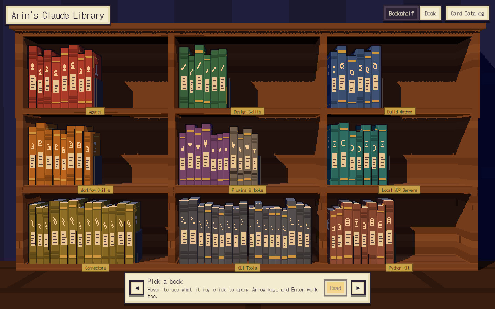

## What's inside

The bookshelf holds 95 books on 9 shelves: agents, design skills, build method skills, workflow skills, plugins and hooks, local MCP servers, connectors, CLI tools and Python packages. Spine color tells you the shelf. Grey spines are installed but switched off.

The desk next to it holds:

- **The Vault**, a file organizer with one file per Obsidian folder. Each file says what the folder is for, what goes in, what stays out and its rules. The last two files cover indexes, tags, the note template and a prompt to set up the same vault. The file colors match the vault's colored sidebar.
- **The plugin phone**, an old keypad phone. Scroll its menus to see every Obsidian plugin, theme and CSS snippet behind the vault's look, with links to install each one.
- **The Claude Handbook**, the rules Claude follows here, in ten chapters: how it talks to me, the ADHD working rules, the banned writing tells, which skills are mandatory, the antislop design filter and more. It opens on a contents page you can click, and every chapter opens with Clawd, the Claude Code crab, in a different outfit.
- A fishbowl with a clownfish, because a desk needs one.

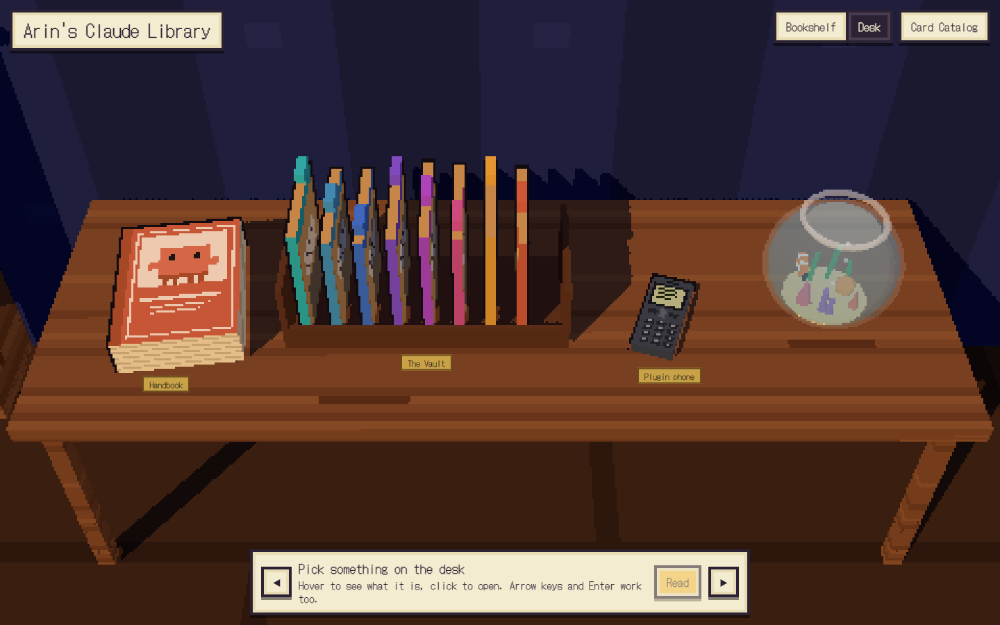

| Open book | Page turn | Install page |
|---|---|---|
| 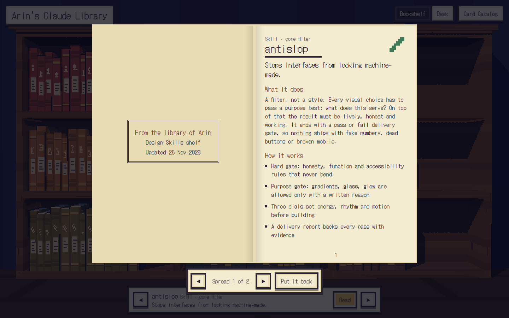 | 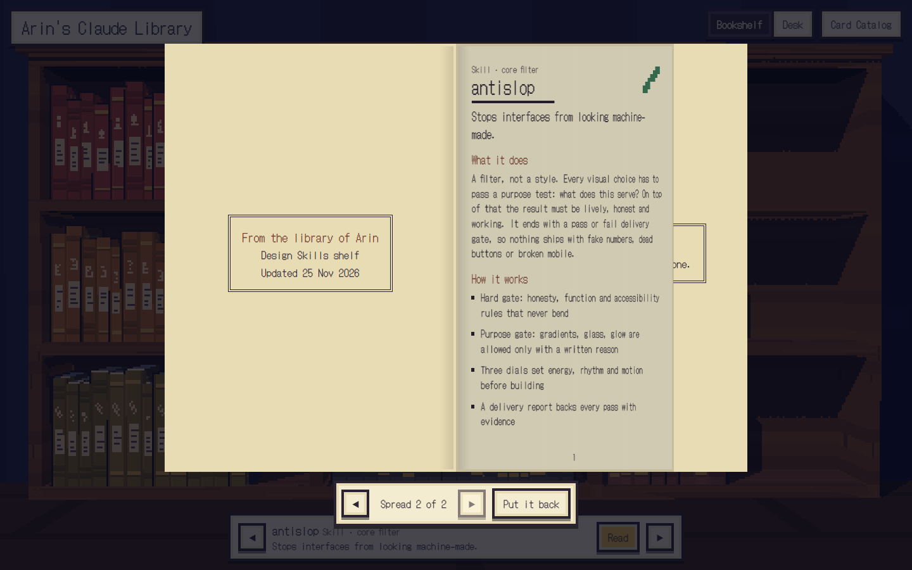 | 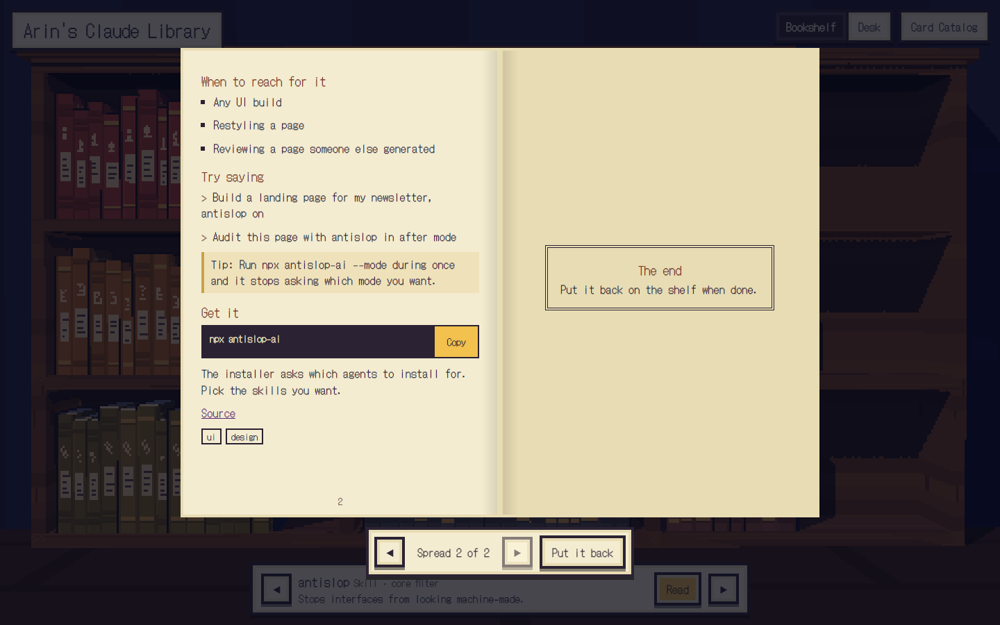 |

| Handbook contents | A chapter opener | A vault file |
|---|---|---|
| 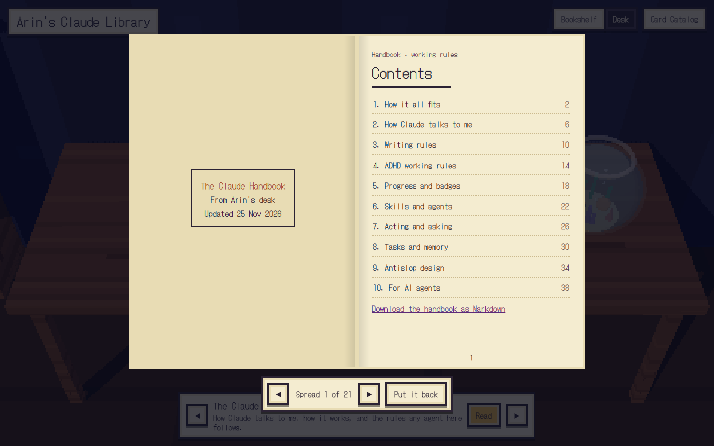 | 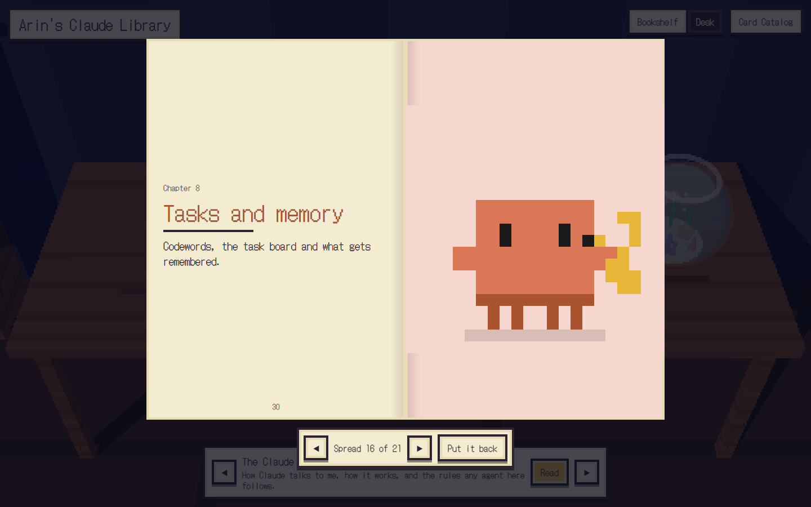 | 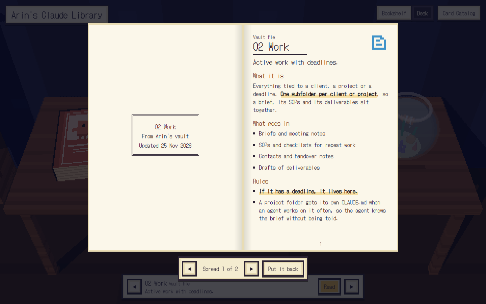 |

| The plugin phone | Handbook pages | Closing a book |
|---|---|---|
| 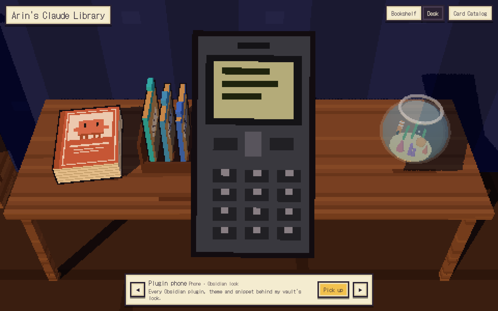 | 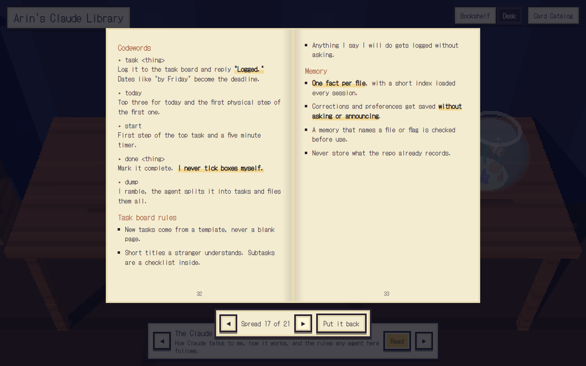 | 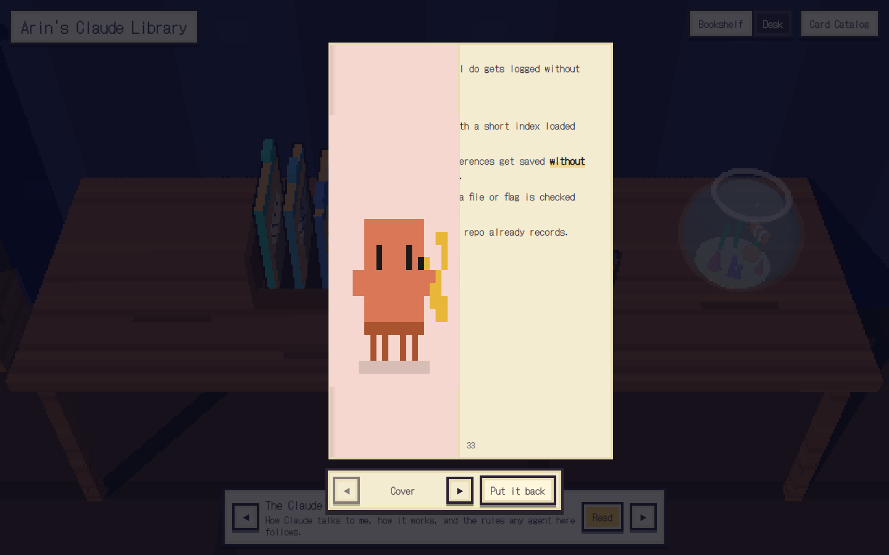 |

On a phone the shelf becomes one tall bookcase you scroll, and books open one page at a time.

<p>
  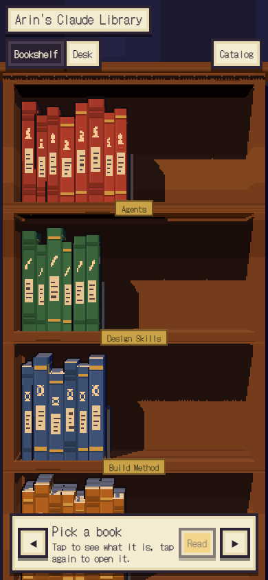
  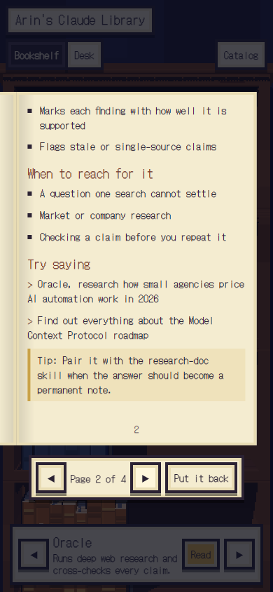
  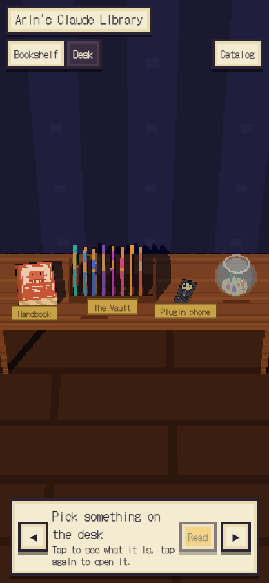
</p>

## Take what you want

Every book ends with a **Get it** page: an install command with a copy button, plus a download link where there is a file. Some of it is mine and lives in this repo:

| What | Where | Install |
|---|---|---|
| 8 agents (Robert, Stark, Oracle, Cortana, Aurther, Jarvis, Friday, Alfread) | [`kit/agents`](kit/agents) | Drop the `.md` file in `~/.claude/agents/` |
| Skills: research-doc, transcribe, transcribe-phone | [`kit/skills`](kit/skills) | `npx degit Arin117Kaushik/claude-library/kit/skills/<name> ~/.claude/skills/<name>` |
| Skill-lock hook | [`kit/hooks/skill_lock.py`](kit/hooks/skill_lock.py) | Copy it to `~/.claude/hooks/` and register it in `settings.json` |
| ADHD Strict output style | [`kit/output-styles`](kit/output-styles) | Copy it to `~/.claude/output-styles/` |
| Colored sidebar snippet for Obsidian | [`kit/obsidian`](kit/obsidian) | Copy it to `.obsidian/snippets/` |

The agent files are generic versions of mine, with my personal details taken out. Read them before installing, then add your own context.

### For your AI agent

Everything in the room is also plain Markdown, so you can hand it straight to Claude or any other agent:

- [`kit/LIBRARY.md`](kit/LIBRARY.md): every book, with install commands
- [`kit/RULES.md`](kit/RULES.md): the working rules
- [`kit/VAULT.md`](kit/VAULT.md): the vault structure and a setup prompt
- [`kit/OBSIDIAN.md`](kit/OBSIDIAN.md): the Obsidian plugins and theme

Try: *"Read RULES.md and VAULT.md from Arin117Kaushik/claude-library and set up my vault and working rules the same way."*

## Make your own library

Fork the repo and edit two files. No build step.

- **`library.js`** holds the shelves and books. Each book has a name, a one-line blurb, what it does, how it works, when to use it, example prompts, a tip and an install command. Only the name, kind, blurb and description are required.
- **`desk.js`** holds the vault files, the phone menus and the handbook chapters. Text in either file can use `**bold**`.

```js
{ n: 'Stark', k: 'Agent · strategist', b: 'Talks a decision through and ends with one recommendation.',
  w: 'A thinking partner for choices...',
  how: ['Finds the actual decision', 'Answers in a fixed shape'],
  u: ['Should I do X or Y'],
  ex: ['Should I learn n8n or Python first?'],
  get: { cmd: 'curl ... -o ~/.claude/agents/stark.md', file: 'kit/agents/stark.md' } }
```

Pages are laid out automatically, so a long description just gets more pages.

Run it locally:

```
python -m http.server 8791
```

Then open http://127.0.0.1:8791. It needs a local server because it uses ES modules. three.js and the font are vendored in `vendor/`, so it works offline.

After editing, `node tools/export.mjs` regenerates the Markdown in `kit/`, and `python tools/shoot.py` retakes the screenshots and runs a smoke test of every interaction.

## Controls

| | Mouse | Touch | Keyboard |
|---|---|---|---|
| Pick a book | Hover a spine | Tap once | Tab to the room, then arrow keys |
| Open it | Click | Tap again, or Read | Enter |
| Turn pages | Click the page edge | Swipe | Left and right arrows, Home, End |
| Put it back | Click outside it, or Put it back | Tap outside it | Escape |
| Phone menus | Click a row | Tap a row | Up, down, Enter, Backspace, or number keys |
| Switch rooms | Bookshelf and Desk tabs, or scroll down for the desk and up for the shelf | Tabs | Arrow right past the last book on a right-hand shelf walks to the desk. Arrow left from the first desk item walks back. Before you pick anything, left and right switch rooms directly. |
| Search | Card catalog | Card catalog | Press `/` |

The **Card catalog** lists every item and has a search box.

Every item has its own link: opening one puts it in the address bar, like `#/stark` or `#/the-claude-handbook`, so you can share a single book.

## How it's built

- **three.js** renders the room at a third of screen resolution, then scales it up with hard pixels, so the 3D reads as pixel art. Every texture is drawn on a tiny canvas in code: no image files.
- When you open a book, the 3D book flies to exactly where the HTML book appears, then hands over. Text in books stays crisp, selectable and readable by screen readers.
- The page curl splits a turning page into eight hinged strips that bend one after another, so the free edge leads like real paper. At rest a page is a single normal element. Closing swings every turned page shut together, like a real cover.
- Pages are measured as they are filled, so content flows onto as many pages as it needs. Handbook chapters always open on a left page with the art on the right.
- Clawd and his ten outfits are tiny sprites drawn in code, one string per row of pixels.
- Built under the [antislop](https://github.com/miqdadbadjuber/anti-slop) design rules: one gold accent, a game-style dialog box as the identity motif, full keyboard use, and real content only.

## Credits

Built with [Claude Code](https://claude.com/claude-code). [three.js](https://threejs.org) (MIT). [DotGothic16](https://fonts.google.com/specimen/DotGothic16) by Fontworks (SIL Open Font License). The transcribe skill is a Windows port of Hugo Manning's [transcribe-skill](https://github.com/learnaiwithhugo/transcribe-skill) (MIT). Jarvis, Cortana and Friday started from [VoltAgent's subagents](https://github.com/VoltAgent/awesome-claude-code-subagents). Third-party skills and plugins on the shelves belong to their authors and link to their sources.

## License

MIT for the library code and my own files in `kit/`. Third-party files keep their own licenses.
